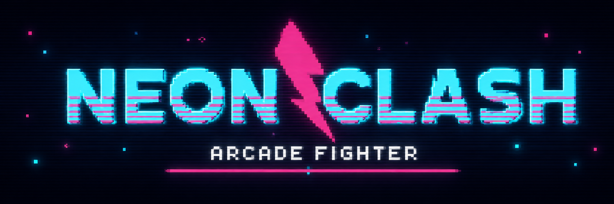
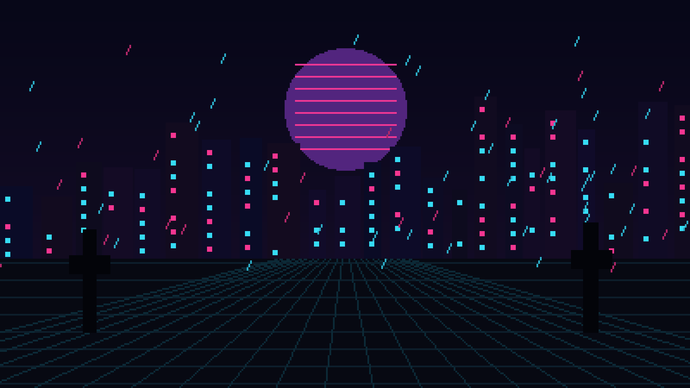
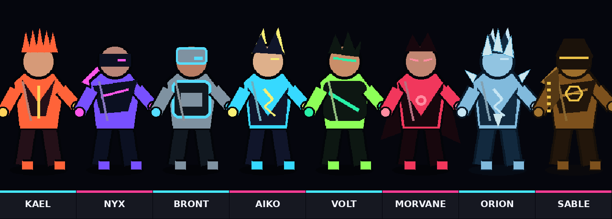
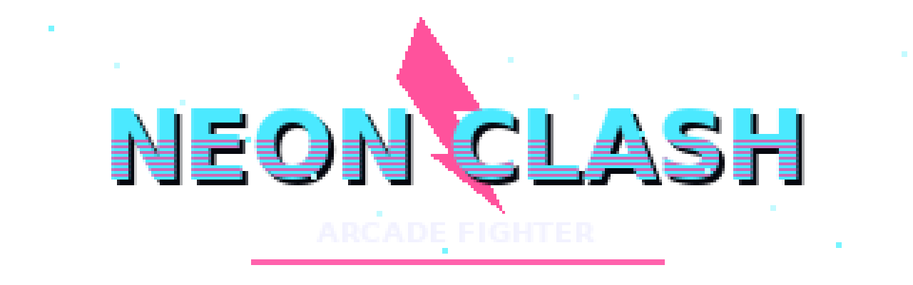

<div align="center">



### ⚡ PIXEL ARCADE FIGHTER

**Um jogo de luta 2D para navegador com 8 lutadores, campanha Arena, Treino, Versus, Survival, especiais, finalizações e suporte a gamepad.**


[🎮 Modos](#-modos-de-jogo) •
[🥊 Lutadores](#-lutadores) •
[⌨️ Controles](#️-controles) •
[🕹️ Gamepad](#️-controle-xbox--playstation) •
[⚙️ Opções](#️-opções) •
[🚀 Executar](#-como-executar)

</div>

---

## 🌃 Visão geral

**NEON CLASH** é um fighting game 2D construído para rodar diretamente no navegador.

A versão **Pixel Arcade Edition** transforma o projeto em uma experiência mais próxima de um jogo de fliperama:

- tela inicial em pixel art com **PRESS START**;
- menu principal;
- oito personagens jogáveis;
- campanha de oito lutas;
- luta espelho contra o próprio personagem;
- modo treino;
- versus local e contra CPU;
- survival;
- finalizações;
- controles por teclado ou gamepad;
- configurações persistentes no navegador;
- spritesheets próprios;
- hitboxes reais e frames ativos.



---

## 🎮 Modos de jogo

### 🏆 Modo Arena

O modo principal do jogo.

Você escolhe um dos **8 lutadores** e inicia uma rota de oito confrontos.

```text
LUTA 1
   ↓
LUTA 2
   ↓
LUTA 3
   ↓
  ...
   ↓
LUTA 7
   ↓
LUTA 8 — MIRROR MATCH
   ↓
GAME CLEAR
```

A rota contém:

- os outros **7 personagens** do elenco;
- uma luta final contra **o mesmo personagem que você escolheu**;
- dificuldade progressivamente maior;
- alternância automática entre as arenas;
- barra visual de progresso;
- `GAME OVER` caso perca;
- opção para repetir a luta atual;
- tela de **GAME CLEAR** ao vencer 8/8.

A última luta permite executar a finalização especial do personagem.

---

### 🥋 Modo Treino

Ambiente livre para aprender o sistema de combate.

O adversário é o **DUMMY MK-I**, um boneco de treino que não ataca.

No treino:

- tempo infinito;
- mana infinita;
- stamina infinita;
- especial sempre disponível;
- dummy parado;
- vida do dummy restaurada;
- hitbox debug disponível;
- reset rápido das posições com `R`.

Ideal para aprender:

```text
hit confirm
combos
alcance
startup
active frames
recovery
dash
defesa
quarter-circle
especial
finalização
```

---

### ⚔️ Versus

Combate tradicional.

Você pode escolher:

#### 1P VS CPU

Um jogador enfrenta a inteligência artificial.

Níveis:

- Fácil
- Normal
- Difícil

#### 2P Local

Dois jogadores no mesmo computador.

Exemplos:

```text
Teclado + Teclado
Controle + Teclado
Controle + Controle
```

---

### 💀 Survival

Um modo adicional de resistência.

Após cada vitória:

- um novo adversário aparece;
- o cenário pode mudar;
- a IA fica progressivamente mais agressiva;
- parte da sua vida é recuperada;
- a sequência continua até você perder.

O melhor resultado é armazenado no navegador:

```text
SURVIVAL RECORD
```

---

## 🥊 Lutadores



| # | Personagem | Arquétipo | Especial | Finalização |
|---:|---|---|---|---|
| 01 | **Kael Ignis** | Brawler | Supernova | Sol Absoluto |
| 02 | **Nyx Vesper** | Assassin | Eclipse | Zero Lunar |
| 03 | **Bront Titan** | Tank | Tremor Ômega | Núcleo de Titã |
| 04 | **Aiko Raijin** | Caster | Tempestade Raijin | Deusa do Trovão |
| 05 | **Volt Rex** | Rushdown | Overdrive | Velocidade Terminal |
| 06 | **Morvane** | Drain | Pacto de Sangue | Trono Carmesim |
| 07 | **Orion Frost** | Cryomancer | Inverno Absoluto | Zero Kelvin |
| 08 | **Sable Hex** | Hex Assassin | Maldição Binária | Blackout Hex |

<details>
<summary><b>🔥 Kael Ignis</b></summary>

**O Punho Solar**

Focado em pressão e dano físico.

- poder alto;
- projétil de fogo;
- forte combate a curta distância;
- comando: **Onda Solar**;
- especial: **Supernova**;
- finalização: **Sol Absoluto**.

</details>

<details>
<summary><b>🌑 Nyx Vesper</b></summary>

**A Lâmina do Vazio**

Assassina de alta velocidade.

- teleporte;
- alto potencial de combo;
- projétil rápido;
- comando: **Corte Fantasma**;
- especial: **Eclipse**;
- finalização: **Zero Lunar**.

</details>

<details>
<summary><b>⚙️ Bront Titan</b></summary>

**O Colosso de Ferro**

O personagem mais resistente do elenco.

- defesa extrema;
- maior dano bruto;
- ataques sísmicos;
- quebra de guarda;
- especial: **Tremor Ômega**;
- finalização: **Núcleo de Titã**.

</details>

<details>
<summary><b>⚡ Aiko Raijin</b></summary>

**A Dançarina da Tempestade**

Especialista em energia e controle de espaço.

- excelente regeneração de mana;
- ataques elétricos;
- raios verticais;
- comando: **Arco Elétrico**;
- especial: **Tempestade Raijin**;
- finalização: **Deusa do Trovão**.

</details>

<details>
<summary><b>☢️ Volt Rex</b></summary>

**O Predador Cinético**

Personagem agressivo de rushdown.

- dash veloz;
- mobilidade alta;
- pressão constante;
- comando: **Ruptura Cinética**;
- especial: **Overdrive**;
- finalização: **Velocidade Terminal**.

</details>

<details>
<summary><b>🩸 Morvane</b></summary>

**O Arauto Carmesim**

Manipula energia vital.

- ataques de médio alcance;
- projéteis carmesim;
- roubo de vida;
- comando: **Orbe Hemático**;
- especial: **Pacto de Sangue**;
- finalização: **Trono Carmesim**.

</details>

<details>
<summary><b>❄️ Orion Frost</b></summary>

**O Herdeiro do Zero**

Criomante especializado em controle.

- rajadas de gelo;
- efeito de congelamento;
- três lanças de gelo no comando;
- especial: **Inverno Absoluto**;
- finalização: **Zero Kelvin**.

</details>

<details>
<summary><b>🔶 Sable Hex</b></summary>

**A Bruxa do Circuito**

Assassina baseada em teleporte e energia arcana.

- alta velocidade;
- projéteis hexagonais;
- drenagem de mana;
- teleporte ofensivo;
- especial: **Maldição Binária**;
- finalização: **Blackout Hex**.

</details>

---

## ❤️ Sistema de combate

Cada lutador possui quatro recursos principais.

| Recurso | Função |
|---|---|
| ❤️ **Vida** | Chegando a zero, o round termina |
| 🔵 **Mana** | Consumida por poderes e comandos |
| 🟡 **Stamina** | Consumida por golpes físicos, defesa, dash e pulo |
| 🟣 **Especial** | Enche durante o combate e libera o super |

O motor também possui:

- combos;
- defesa;
- guard break;
- dash;
- invulnerabilidade curta no dash;
- knockback;
- projéteis;
- especiais;
- finalizações;
- wall recoil;
- screen shake;
- hit sparks;
- partículas;
- afterimages;
- câmera dinâmica.

---

## 📦 Hitbox, Hurtbox e Pushbox

O sistema de colisão não depende apenas da imagem do personagem.

Cada lutador possui:

### 🟢 Hurtbox

Área onde ele pode receber dano.

### 🔴 Attack Box

Área ativa do golpe.

Só existe durante os **active frames**.

### 🔵 Pushbox

Impede dois personagens de ocuparem o mesmo espaço.

Pressione:

```text
F2
```

para ativar o modo visual.

---

## ⏱️ Startup → Active → Recovery

Os ataques são divididos em três etapas.

```text
┌─────────┬──────────────┬──────────┐
│ STARTUP │ ACTIVE FRAME │ RECOVERY │
└─────────┴──────────────┴──────────┘
```

Isso permite ajustar cada golpe individualmente e deixa o combate mais próximo de um fighting game tradicional.

---

## ⌨️ Controles

### Player 1

| Ação | Tecla |
|---|---|
| Esquerda | `A` |
| Direita | `D` |
| Pular | `W` |
| Defender | `S` |
| Soco | `J` |
| Chute | `K` |
| Poder | `L` |
| Especial / Finalização | `U` |
| Dash | `I` |
| Reset no treino | `R` |
| Hitbox Debug | `F2` |
| Pausa | `ESC` |

### Mouse e touchscreen

- todos os menus e a tela `PRESS START` respondem a clique ou toque;
- no desktop, `CONTROLES: ON` exibe comandos clicáveis durante a luta;
- em celulares e tablets, o direcional e os botões de golpe aparecem automaticamente;
- o direcional touch reconhece `↓ → + SOCO` pelo mesmo buffer de comandos;
- durante o combate móvel, o jogo orienta o uso da tela horizontal.

### Player 2

| Ação | Tecla |
|---|---|
| Esquerda | `←` |
| Direita | `→` |
| Pular | `↑` |
| Defender | `↓` |
| Soco | `1` |
| Chute | `2` |
| Poder | `3` |
| Especial / Finalização | `4` |
| Dash | `5` |

---

## 🌀 Comandos

Existe buffer de comandos para movimentos especiais.

### Quarter Circle Forward

```text
↓ → + SOCO
```

`→` significa **para frente**, portanto muda automaticamente quando o personagem troca de lado.

Cada lutador executa um movimento diferente.

---

## 🕹️ Controle Xbox / PlayStation

O jogo usa a **Gamepad API** do navegador.

### Xbox

| Ação | Controle |
|---|---|
| Movimento | Analógico / D-Pad |
| Pular | `↑` |
| Soco | `A` |
| Chute | `B` |
| Poder | `X` |
| Especial | `Y` |
| Defender | `LB` |
| Dash | `RB` |
| Pausa | `Menu` |

### PlayStation

| Ação | Controle |
|---|---|
| Movimento | Analógico / D-Pad |
| Pular | `↑` |
| Soco | `X` |
| Chute | `○` |
| Poder | `□` |
| Especial | `△` |
| Defender | `L1` |
| Dash | `R1` |
| Pausa | `Options` |

O primeiro controle conectado pode navegar pelo menu principal usando D-Pad/analógico e `A / X`.

Teclado, mouse, touchscreen e gamepad podem coexistir em dispositivos híbridos.

---

## ⚙️ Opções

As preferências são armazenadas com `localStorage`.

O menu permite alterar:

- áudio;
- volume;
- screen shake;
- câmera dinâmica;
- hitbox debug;
- dificuldade padrão;
- tela cheia.

Os valores permanecem salvos depois de fechar o navegador.

---

## 🎨 Pixel Art

A identidade visual da versão 3 utiliza assets pixelizados próprios:

```text
assets/ui/
├── neon_clash_logo_pixel.gif
├── neon_clash_logo_pixel.png
├── title_background_pixel.png
└── menu_background_pixel.png
```

O logo animado usado neste README é o mesmo da tela inicial do jogo.

Os sprites são organizados por personagem.

Cada personagem possui:

```text
idle
walk
jump
fall
punch
kick
hurt
ko
special
finisher
```

São **90 spritesheets PNG** no total considerando os oito lutadores e o dummy de treino.

---

## 🧠 Inteligência Artificial

A CPU considera:

- distância até o jogador;
- mana;
- stamina;
- vida;
- barra de especial;
- alcance;
- probabilidade de defesa;
- dash;
- golpes físicos;
- poderes;
- comandos;
- especiais.

No Modo Arena e Survival a agressividade aumenta conforme o jogador avança.

---

## 🔊 Áudio

Os efeitos são sintetizados em tempo real com:

```text
Web Audio API
```

Isso reduz a necessidade de arquivos externos para:

- impactos;
- golpes;
- poderes;
- seleção;
- K.O.;
- especiais.

---

## 🚀 Como executar

### Método recomendado no Windows

Execute:

```text
START_GAME.bat
```

O inicializador procura automaticamente:

1. `py`
2. `python`
3. `npx`

Quando encontra um deles, inicia:

```text
http://localhost:8080
```

Essa é a forma recomendada para obter melhor compatibilidade com:

- gamepads;
- áudio;
- tela cheia;
- APIs modernas do navegador.

### PowerShell

Também existe:

```text
START_GAME.ps1
```

### Manual

Com Python:

```bash
python -m http.server 8080
```

Depois abra:

```text
http://localhost:8080
```

Com Node:

```bash
npx serve . -l 8080
```

---

## 📁 Estrutura

```text
neon_clash_v3/
│
├── index.html
├── styles.css
├── game.js
├── README.md
├── CHANGELOG.md
├── LICENSE
├── START_GAME.bat
├── START_GAME.ps1
│
└── assets/
    ├── fighters.json
    │
    ├── ui/
    │   ├── neon_clash_logo_pixel.gif
    │   ├── neon_clash_logo_pixel.png
    │   ├── title_background_pixel.png
    │   └── menu_background_pixel.png
    │
    └── fighters/
        ├── kael/
        ├── nyx/
        ├── bront/
        ├── aiko/
        ├── volt/
        ├── morvane/
        ├── orion/
        ├── sable/
        └── dummy/
```

---

## 🧱 Stack

```text
HTML5
CSS3
JavaScript ES6+
Canvas 2D
Web Audio API
Gamepad API
LocalStorage API
Fullscreen API
```

Sem framework obrigatório e sem build step.

---

## 🧪 Ferramentas para desenvolvimento

Ative durante a luta:

```text
F2
```

para visualizar as colisões.

Isso facilita o balanceamento de:

- alcance;
- tamanho da hurtbox;
- active frames;
- distância de golpes;
- especiais.

---

## 💾 Dados salvos localmente

O jogo armazena no navegador:

```text
neonClashSettings
neonClashSurvivalRecord
neonClashArcadeClears
```

Nenhum banco de dados é necessário.

---

## 🗺️ Roadmap

- [x] 8 lutadores
- [x] pixel-art title screen
- [x] menu principal
- [x] Modo Arena
- [x] Modo Treino
- [x] Versus
- [x] Survival
- [x] gamepad
- [x] finalizações
- [x] hitbox debug
- [x] configurações persistentes
- [x] tela cheia
- [x] controles touchscreen
- [x] layout móvel horizontal
- [x] qualidade gráfica adaptativa
- [x] versão PWA instalável
- [ ] seleção de skins
- [ ] golpes agarrão
- [ ] crouch attacks
- [ ] air combos avançados
- [ ] command list dentro do pause
- [ ] achievements
- [ ] chefes secretos
- [ ] ranking local
- [ ] replay system
- [ ] multiplayer online

---

## 📚 Referências técnicas

O motor utiliza conceitos comuns de jogos de luta 2D e foi estudado também a partir do projeto educacional de Chris Courses:

- `JavaScript Fighting Game Tutorial with HTML Canvas`
- `chriscourses/fighting-game`

Foram utilizados conceitos gerais como:

- `requestAnimationFrame`;
- classes de sprites;
- estados de animação;
- gravidade;
- attack boxes;
- colisão retangular.

Os personagens, sistema de mana/stamina/especial, modos de jogo, interface, identidade visual, finalizações, IA, sprites e implementação do **NEON CLASH** são próprios.

---

## 📄 Licença

Distribuído sob a licença **MIT**.

---

<div align="center">



**PRESS START. ENTER THE CLASH.**

</div>
